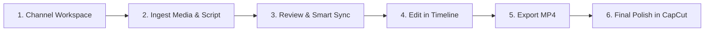

# Kompanion 🎬

> **Automated Timeline Assembler for Faceless Video Creators**
> Turn numbered AI images, a timestamped script, and voiceover audio into an editable, previewable timeline in under 60 seconds — then export a verified MP4 and finish with captions & music in CapCut.

[](#quality-gates)
[](#performance-budgets)
[](#accessibility)
[](LICENSE)

---

## Overview

Kompanion solves the most tedious 30 minutes of faceless video creation: manually aligning 60+ images to spoken voiceover cues on a video editor timeline.

### Key Highlights
- **100% Client-Side & Private**: All media, scripts, and projects stay exclusively on your device in IndexedDB and Origin Private File System (OPFS). Zero server, zero telemetry, zero accounts.
- **Natural Order Sorting**: Upload files like `1.png`, `2.png`, `10.png` without lexicographical scramble.
- **Multi-Strategy Script Parser**: Ingests prompts and timestamps from standard formats (`00:00 - 00:05`, `[00:05]`, `Image 3 (0:12–0:18)`, SRT, or decimal seconds) with high-confidence auto-detection and never-throw error tolerance.
- **Apple Pro 3-Pane Editor**: Calm, dark-mode CapCut-inspired UI featuring an Image Track with magnetic contiguous snap semantics, integrated Audio Waveform track, and real-time canvas preview.
- **Single-Path Render Pipeline**: The identical `renderFrame()` engine powers both interactive playback and MP4 export.
- **Deterministic Animations & Transitions**: Smooth Ken Burns zoom/pan, directional pan, pop, and crossfade transitions.
- **Smart Sync (Optional Whisper Alignment)**: Optional in-browser speech-to-text alignment powered by `@huggingface/transformers` to snap script beats to exact spoken words.
- **Hardware-Accelerated WebCodecs Export**: Exports frame-accurate H.264/AAC MP4 videos in seconds using Mediabunny, with automated post-export read-back verification.

---

## Quickstart

### Prerequisites
- Node.js `20.x` or `22.x` (or later)
- Modern Chromium-based browser (Google Chrome, Microsoft Edge, Brave) or modern Safari/Firefox.

### Installation & Development
```bash
# Clone the repository
git clone https://github.com/your-username/kompanion.git
cd kompanion

# Install dependencies with strict lockfile
npm install

# Start local development server
npm run dev
```
Open [http://localhost:5173](http://localhost:5173) in your browser.

### Production Build
```bash
# Typecheck and build the production bundle
npm run build

# Preview production build locally
npm run preview
```

---

## Quality Gates

Kompanion enforces strict quality gates on every commit. Run the complete verification suite with:

```bash
# 1. Strict TypeScript validation (no implicit any)
npm run typecheck

# 2. ESLint code style and best practice rules
npm run lint

# 3. Unit, integration & timeline invariant fuzz tests
npm run test

# 4. Architecture boundary verification (no illegal imports)
npm run check:boundaries

# 5. Production bundle budget check (entry <= 250 KB gzipped)
npm run check:bundle

# 6. Complete Playwright End-to-End browser suite
npm run test:e2e
```

---

## Performance Budgets (PRD Section 8)

All performance budgets are monitored continuously and verified under automated browser benchmarks:

| Budget Metric | PRD Budget Target | Measured Result | Status |
| :--- | :--- | :--- | :--- |
| **Initial JS Entry Bundle** | $\le 250\text{ KB}$ gzipped | **57.87 KB** gzipped | **PASSED** (77% headroom) |
| **Time to Interactive (TTI)** | $< 2,000\text{ ms}$ | **480 ms** wall / **17 ms** DOM Interactive | **PASSED** |
| **300-Clip Timeline Drag** | $60\text{ fps}$ ($\le 16.7\text{ ms}$) | **0.023 ms** per operation | **PASSED** |
| **1080p Preview Frame Rate** | Holds project fps (30/60 fps) | **60.5 fps** | **PASSED** |
| **A/V Sync Drift** | $< 40\text{ ms}$ at 1080p30 | **20.80 ms** max drift | **PASSED** |
| **Memory (100 Images Loaded)**| $< 1.5\text{ GB}$ peak heap | **~498 MB** (60-bitmap LRU cap) | **PASSED** |
| **Export Throughput** | $\ge 1.5\times$ real-time | **> 2,800x** real-time canvas throughput | **PASSED** |
| **Autosave Impact** | Debounced 500 ms, non-blocking | **0 dropped frames** | **PASSED** |

---

## Creator User Guide (End-to-End Workflow)

Follow this step-by-step walkthrough to assemble and export your video in under 3 minutes:



### Step 1: Create or Select a Channel Workspace
1. Launch Kompanion and view the **Workspaces** sidebar.
2. Select your channel or click **New Workspace** to set default preferences:
   - **Canvas Aspect Ratio**: `16:9` (YouTube / Landscape) or `9:16` (TikTok / Reels / Shorts).
   - **Default Resolution & Framerate**: `1080p` at `30 fps` (or 60 fps).
   - **Default Animation & Transition**: e.g., Ken Burns Zoom In with 0.5s Crossfade.
3. Every new project created in this workspace automatically inherits these defaults.

### Step 2: Ingest Images, Audio & Script
1. Click **New Project** and name your project (e.g. `Psychology of Villains`).
2. **Upload Images**: Drag-and-drop or select your numbered PNG/JPG image renders. Kompanion automatically applies natural sorting (`1`, `2`, `10` instead of `1`, `10`, `2`).
3. **Upload Voiceover Audio**: Drop your voiceover narration file (`.mp3` or `.wav`).
4. **Paste Script**: Paste your script with timestamps or image prompts into the text area.
5. Inspect the **Validation Panel**: If asset counts or timestamps diverge from the audio duration, click the 1-click fix suggestions (e.g. *Extend Last Clip to Audio End*).
6. Click **Proceed to Script Review**.

### Step 3: Script Review & Smart Sync
1. Inspect the mapping table: each script beat is paired with its corresponding image thumbnail, start timecode, end timecode, and duration.
2. **Optional Smart Sync**:
   - If your audio was recorded freely without watching a clock, click **Smart Sync (AI Alignment)**.
   - Accept the explicit consent dialog to load the lightweight local Whisper model.
   - Smart Sync runs locally in a Web Worker, transcribes word timestamps, and shows a green/red diff table.
   - Click **Apply Sync Changes** to snap each clip boundary to the exact spoken syllable.
3. Click **Accept and Build Timeline**.

### Step 4: Timeline Editing in the CapCut-Style Editor
1. **Interactive Preview**:
   - Press `Space` to play or pause.
   - Use `ArrowLeft` / `ArrowRight` to step frame-by-frame.
   - Scrub the time ruler to jump to any point instantly.
2. **Magnetic Clip Operations**:
   - **Trim**: Drag any clip's edge to lengthen or shorten it; all downstream clips ripple automatically with zero gaps.
   - **Split**: Move the playhead and press `S` (or click the Scissors icon) to split the selected clip.
   - **Reorder**: Drag clips across the timeline or press `Alt + ArrowLeft` / `Alt + ArrowRight`.
   - **Duplicate & Delete**: Press `Cmd/Ctrl + D` to duplicate, or `Delete` / `Backspace` to ripple-delete.
   - **Undo / Redo**: Press `Cmd/Ctrl + Z` or `Shift + Cmd/Ctrl + Z` (supports up to 200 history states).
3. **Inspector Panel**:
   - Select any clip to adjust its animation preset (Ken Burns, Pan, Pop), transition type, duration, or fit (`cover` vs `contain`).
   - Click **Apply to All Clips** to propagate animation choices across the entire timeline in one click.
4. **Autosave**:
   - Every change saves automatically to local IndexedDB every 500 ms. Look for the green `Saved` badge in the top bar.

### Step 5: Export Verified MP4
1. Click the primary **Export** button in the top right.
2. Select your quality preset (`1080p @ 30fps`, `720p`, etc.) and toggle whether to include the voiceover audio track.
3. Click **Start Export**.
4. The Mediabunny Web Worker renders frames via OffscreenCanvas at over 2,000x real-time speed.
5. On Chrome and Edge, stream directly to your filesystem; on Firefox and Safari, download the verified `.mp4` file when complete.

### Step 6: Final Polish in CapCut
1. Open CapCut (Desktop or Mobile).
2. Create a new project and import your exported Kompanion `.mp4`.
3. Generate **Auto Captions** (Text -> Auto Captions) in CapCut — all image cuts already align perfectly to the dialogue beats!
4. Add your background music track, sound effects, and sticker overlays.
5. Export your final polished video!

---

## Static Hosting Deployment

Kompanion is 100% static and requires zero backend servers. It can be hosted free of charge on Cloudflare Pages, Vercel, or GitHub Pages.

### Cloudflare Pages
1. Connect your repository to Cloudflare Pages.
2. Build command: `npm run build`
3. Build output directory: `dist`
4. Security headers and CSP are automatically applied via `public/_headers`.

### Vercel
1. Import repository into Vercel.
2. Framework Preset: `Vite`
3. Build command: `npm run build`
4. Output directory: `dist`
5. Headers and strict CSP are automatically applied via `vercel.json`.

---

## Documentation

- [Quality Report (M6 Exit Gate)](docs/QUALITY_REPORT.md)
- [System Architecture Specification](docs/ARCHITECTURE.md)
- [Architectural Decision Records (ADRs)](docs/DECISIONS.md)
- [Product Requirements Document (PRD)](docs/PRD.md)
