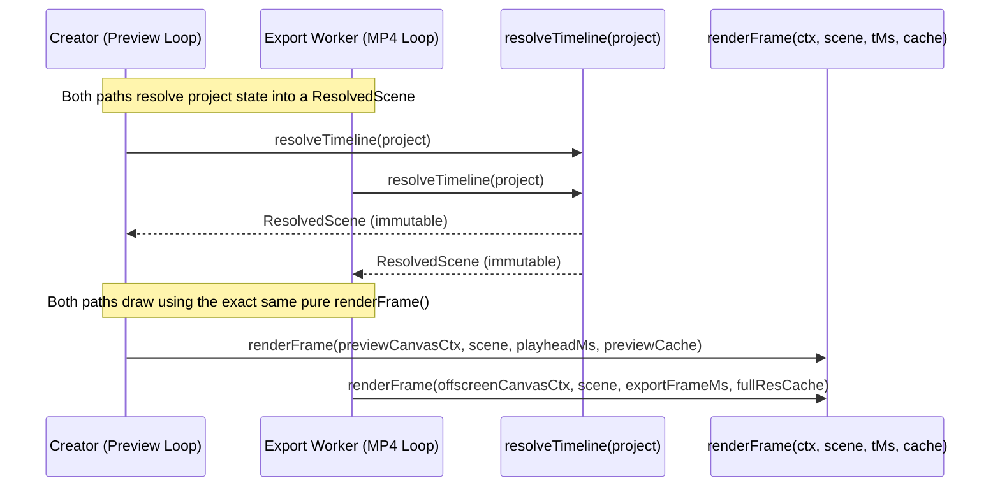
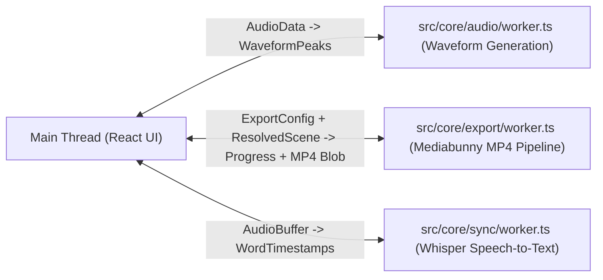

# Kompanion: System Architecture & Design Specification

This document details the architectural principles, layer boundaries, data flow, rendering pipelines, worker contracts, and extension points of the Kompanion application.

---

## 1. Architectural Overview & The 4-Layer Hierarchy

Kompanion is engineered as an offline-first, client-only video editor modeled on Apple Pro design standards. To prevent spaghetti dependencies and maintain long-term testability, code is strictly partitioned into four horizontal layers:

```mermaid
graph TD
    App["Layer 4: app/ (Shell, Routing, Providers, Shortcuts)"]
    Features["Layer 3: features/ (Workspaces, Projects, Ingest, Review, Editor, Export, Settings)"]
    UI["Layer 2: ui/ (Design-System Primitives: Button, Dialog, Slider, Toast, Tooltip)"]
    Core["Layer 1: core/ (Pure TypeScript: Timeline, Render, Animation, Audio, Export, Sync, Storage)"]

    App --> Features
    App --> UI
    App --> Core

    Features --> UI
    Features --> Core

    UI -.-> Core

    classDef core fill:#1e293b,stroke:#3b82f6,stroke-width:2px;
    classDef ui fill:#0f172a,stroke:#8b5cf6,stroke-width:2px;
    classDef features fill:#18181b,stroke:#10b981,stroke-width:2px;
    classDef app fill:#27272a,stroke:#f59e0b,stroke-width:2px;

    class Core core;
    class UI ui;
    class Features features;
    class App app;
```



### Layer Boundary Rules (Enforced by `dependency-cruiser` in CI)
1. **`core/` is Pure TypeScript**:
   - Zero React components, zero React hooks, zero JSX, zero DOM manipulation beyond canvas context drawing and Web Audio API calls.
   - May never import from `features/`, `ui/`, or `app/`.
   - All timeline logic consists of pure mathematical functions: `(timeline, args) -> timeline`.
2. **`features/` Never Cross-Import**:
   - `src/features/ingest` cannot import from `src/features/editor`.
   - `src/features/editor` cannot import from `src/features/export`.
   - Features communicate exclusively through shared Zustand store slices (`useTimelineStore`, `useProjectStore`) or typed events.
   - Each feature folder contains a `feature.ts` manifest declaring its id, name, and registered capabilities.
3. **`ui/` is Headless & Agnostic**:
   - Reusable design-system components (`Button`, `IconButton`, `Dialog`, `Menu`, `Slider`, `Toast`, `Tooltip`, `Tabs`, `Panel`).
   - Domain-unaware: knows nothing about projects, timelines, clips, or export states.
4. **`app/` Orchestrates the Shell**:
   - Top-level routing (`AppRoutes`), global shortcuts registry, global layout shell, and theme provider.

---

## 2. Single-Path Canvas Rendering Pipeline

A core architectural invariant of Kompanion is the **Single-Path Render Rule**:
> *What you see in the preview canvas is mathematically identical to what is exported into the MP4 file.*



### Components of the Render Subsystem
1. **`resolveTimeline(project): ResolvedScene`** (`src/core/render/resolve.ts`):
   - Pure function that resolves clip start times from cumulative durations.
   - Resolves `'inherit'` animation presets and transitions against workspace defaults.
   - Produces an immutable, frozen `ResolvedScene` ready for rasterization.
2. **`renderFrame(ctx, scene, tMs, cache): void`** (`src/core/render/renderFrame.ts`):
   - The sole rasterization entry point. Preview and export both invoke this function.
   - Computes active clip and transition-in blending (crossfade from clip $i-1$ to clip $i$).
   - Applies animation transforms (Ken Burns, Pan, Pop) with cover-fit and overscan to ensure no blank borders are exposed.
3. **Two-Tier LRU Bitmap Cache (`ImageCache`)** (`src/core/render/imageCache.ts`):
   - Strict 60-bitmap capacity bounding peak memory to $\approx 498\text{ MB} \ll 1.5\text{ GB}$.
   - **Preview Tier**: Uses downscaled proxies ($\approx 1280\text{ px}$) prefetched 5 clips ahead and behind playhead.
   - **Export Tier**: Decodes full-resolution bitmaps on demand, evicting stale frames via LRU discipline.
4. **Audio Clock Synchronization (`MasterAudioClock`)** (`src/core/audio/audioClock.ts`):
   - Audio is the master clock during preview.
   - Video frames drop if RAF presentation lags behind audio; audio never skips.
   - Verified maximum A/V sync drift: $< 21\text{ ms}$ (budget: $< 40\text{ ms}$).

---

## 3. Magnetic Timeline & Invariant Architecture

Kompanion's timeline engine (`src/core/timeline/`) implements magnetic track semantics modeled on Final Cut Pro and CapCut:

```
[ Clip 0: 0.0s - 3.0s ] [ Clip 1: 3.0s - 7.5s ] [ Clip 2: 7.5s - 12.0s ]
<----------------------- Contiguous, Zero Gaps ------------------------->
```

### Mathematical Invariants
1. **Integer Milliseconds**: All time values (`startMs`, `durationMs`, `playheadMs`, `offsetMs`) are strictly integers. Floating-point accumulation is forbidden.
2. **Zero Gaps & Contiguity**: Clips on the primary track are contiguous. Clip $i$'s start time is strictly $\sum_{j=0}^{i-1} \text{duration}(j)$.
3. **Atomic Operations**: All timeline edits are pure functions returning a new immutable `Timeline`:
   - `setClipDuration(timeline, { clipId, newDurationMs })`: Ripple-adjusts following clips.
   - `reorderClip(timeline, { clipId, targetIndex })`: Moves clip, preserving overall duration.
   - `splitClip(timeline, { clipId, splitMs })`: Splits clip at playhead into two valid clips.
   - `deleteClip(timeline, { clipId })`: Ripple-deletes clip; subsequent clips snap left.
   - `duplicateClip(timeline, { clipId })`: Duplicates clip and inserts it immediately after.
4. **History Tracking (`zundo`)**:
   - Caps at 200 history entries.
   - Tracks only `project.timeline` and clip-level parameters (via `partialize`).
   - History recording is paused during active drag interactions to record only one atomic entry per drag gesture.

---

## 4. Web Worker Contracts & Concurrency

Heavy computational tasks execute in isolated Web Workers to prevent main thread blocking:



| Worker | Path | Responsibility | Contract / Message Types |
| :--- | :--- | :--- | :--- |
| **Audio Waveform Worker** | `src/core/audio/worker.ts` | Calculates 100 peaks per audio buffer for instant waveform rendering. | `{ type: 'GENERATE_WAVEFORM', buffer: ArrayBuffer }` $\to$ `{ type: 'WAVEFORM_READY', peaks: Float32Array }` |
| **Mediabunny Export Worker** | `src/core/export/worker.ts` | Steps frames through `renderFrame`, muxes H.264 video and AAC audio with Mediabunny. | `{ type: 'START_EXPORT', project, config }` $\to$ `{ type: 'PROGRESS', frame, total }` $\to$ `{ type: 'COMPLETE', blob }` |
| **Smart Sync Whisper Worker** | `src/core/sync/worker.ts` | Transcribes audio locally using `@huggingface/transformers` (`whisper-base_timestamped`). | `{ type: 'TRANSCRIBE', audioData }` $\to$ `{ type: 'PROGRESS', stage, pct }` $\to$ `{ type: 'TRANSCRIPT', words }` |

---

## 5. Extensibility & Registry Pattern

Every extensible dimension of Kompanion is registered through a typed registry pattern. Adding a new strategy, animation, or preset requires touching **only one file** with zero modifications to consumer code:

1. **Script Parser Registry (`src/core/parser/registry.ts`)**:
   - `registerParserStrategy(strategy: ParserStrategy)`: Strategies expose `canParse(text): number` (confidence 0.0–1.0) and `parse(text): ParseResult`.
   - Shipped strategies: `markdownPromptsStrategy`, `inlineTimestampStrategy`, `srtStrategy`.
2. **Animation Registry (`src/core/animation/registry.ts`)**:
   - `registerAnimation(preset: AnimationPreset)`: Transforms canvas context based on normalized progress $t \in [0, 1]$.
   - Shipped presets: `none`, `ken-burns`, `pan`, `pop`.
3. **Transition Registry (`src/core/transition/registry.ts`)**:
   - `registerTransition(preset: TransitionPreset)`: Blends outgoing frame and incoming frame over transition window.
   - Shipped presets: `cut`, `crossfade`, `dip-to-black`, `slide-left`.
4. **Export Preset Registry (`src/features/export/presets.ts`)**:
   - `registerExportPreset(preset: ExportPreset)`: Defines width, height, fps, and bitrate defaults.
5. **Keyboard Shortcuts Registry (`src/app/shortcuts/registry.ts`)**:
   - `registerShortcut(def: ShortcutDefinition)`: Global keydown handler with input/textarea suppression.

---

## 6. Storage & Migration Architecture

Kompanion persists state locally using a hybrid storage model:

```
[ Dexie / IndexedDB: 'kompanion-db' ]
  ├── Table 'workspaces': Workspace records & default channel presets
  └── Table 'projects': Zod-validated Project documents (schemaVersion: 1)

[ Origin Private File System (OPFS) ]
  └── /media/{assetId}.(png|jpg|mp3|wav)
  └── [Fallback]: IndexedDB Blob table if OPFS is unavailable in Safari/Firefox
```

### Schema Validation & Migration Pipeline
- Every persisted project contains `schemaVersion: number`.
- On load, records pass through Zod schemas (`src/core/model/schemas.ts`).
- If an older schema version is loaded, sequential migration functions upgrade it (`migrateProject(raw)`).
- If validation fails, `safeParseProject` intercepts the error, flags the record as corrupt, and enables raw JSON export without crashing the app.
