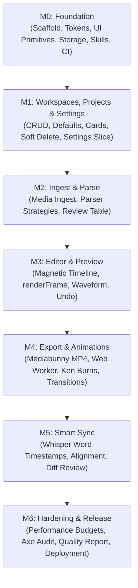

# Kompanion Implementation Plan: Milestones M0 – M6

Based on `docs/PRD.md`, `docs/AGENTS.md`, and `docs/DECISIONS.md` (ADR-0001).

---

## Architectural Principles & Alignment Standards

Every milestone adheres to the core rules codified in `docs/AGENTS.md` and `kompanion-architecture`:

1. **Naming Conventions**:
   - React Components: `PascalCase.tsx` (e.g., `ProjectCard.tsx`, `Timeline.tsx`).
   - Core Modules & Utilities: Consistent per folder (`camelCase.ts` or `kebab-case.ts`).
   - Feature Manifests: `feature.ts` for each slice under `src/features/*`.
   - Web Workers: `worker.ts` within the respective core domain folder (`src/core/**/worker.ts`).
   - Tests: `<name>.test.ts` or `<name>.test.tsx` colocated with the implementation.
2. **Web Worker Entry Points**:
   - Web Workers reside at `src/core/**/worker.ts` (specifically `audio/worker.ts`, `export/worker.ts`, and `sync/worker.ts`).
   - Each worker operates as an entry point with strictly typed message contracts (`RequestMessage` / `ResponseMessage`).
   - Heavy computation (waveform generation, OffscreenCanvas video encoding, Whisper inference) never blocks the UI thread.
3. **Pure Command Architecture & Integer Time**:
   - All timeline coordinates, durations, offsets, and playhead positions are stored as integer milliseconds (`number`). Never accumulate floating-point seconds.
   - All edit operations are pure functions `(timeline, args) -> timeline` wrapped as named commands dispatched through history.
   - History (via `zundo`) tracks only the timeline and clip-level settings; transient UI states (scrubbing, selections, hover) are excluded via `partialize`. Drags are batched into a single command on mouse-up.
4. **Complete UI Primitives List**:
   - The design system in `src/ui/` provides 9 foundational primitives:
     `Button`, `IconButton`, `Slider`, `Tooltip`, `Dialog`, `Menu`, `Toast`, `Tabs`, `Panel`.
5. **Error Handling & Feature Boundaries**:
   - Errors are never swallowed; unexpected errors log with full diagnostic context.
   - Expected operational failures (parse ambiguities, corrupt file imports, unsupported codecs) return typed result objects (`{ ok: true, data } | { ok: false, error }`) rather than throwing.
   - Every feature slice in `src/features/` includes a dedicated `ErrorBoundary` alongside its `feature.ts` manifest to isolate UI failures.
6. **Project Reliability & Data Recovery**:
   - Projects failing Zod schema validation on load never crash the app. The error boundary catches schema mismatches and provides a recovery action to download/export the raw JSON file.

---

## Milestone Overview & Sequencing

---

## Milestone Breakdown

### M0: Foundation
- **Goal**: Establish the production-grade client-only Vite foundation, design system primitives, storage abstractions, schemas, project skills, and CI quality gates under the Kompanion namespace.
- **Deliverables**:
  - Vite + React + TypeScript strict project setup (`"name": "kompanion"`, `<title>Kompanion</title>`).
  - Tailwind CSS configured strictly with design tokens from PRD Section 7 (3 elevation neutral dark grays, accent `#0A84FF`/`#007AFF`, 4pt spacing scale, radius 6/10/14, Apple typography stack).
  - UI primitives in `src/ui/`: `Button`, `IconButton`, `Slider`, `Tooltip`, `Dialog`, `Menu`, `Toast`, `Tabs`, `Panel`.
  - App shell and routing (`/`, `/w/:workspaceId`, `/w/:workspaceId/p/:projectId`) with per-feature error boundaries.
  - Storage layer: Dexie IndexedDB metadata (`kompanion-db`) and OPFS media storage with IndexedDB blob fallback.
  - Domain models & Zod schemas with `schemaVersion: 1` (`Workspace`, `Project`, `Asset`, `Timeline`, `Clip`, `AudioClip`).
  - Corrupt project recovery handler: if Zod schema validation fails on load, display a friendly recovery screen offering to download the project's raw JSON without crashing.
  - Browser compatibility detection screen (checking `VideoEncoder`, `OffscreenCanvas`, OPFS).
  - Initial `docs/DECISIONS.md` (ADR-0001 logged) and `docs/BACKLOG.md`.
  - Authored seven project skills under `.agent/skills/<name>/SKILL.md`:
    1. `kompanion-architecture`
    2. `timeline-engine`
    3. `script-parser`
    4. `render-and-export`
    5. `kompanion-ui`
    6. `quality-gates`
    7. `smart-sync`
  - Hosting configuration for static free tier (Cloudflare Pages `_headers` and Vercel `vercel.json`) with strict Content Security Policy (no `eval`, local assets, no telemetry).
  - Tooling & CI scripts: `npm run typecheck`, `lint`, `test`, `build`, `check:boundaries`, and `check:bundle` (verifying initial entry bundle $\le 250\text{ KB}$ gzipped).
- **Modules**:
  - `src/core/model/`: `types.ts`, `schemas.ts`, `migrations.ts`.
  - `src/core/storage/`: `db.ts` (`kompanion-db`), `opfs.ts`, `storage.ts`.
  - `src/ui/`: `Button.tsx`, `IconButton.tsx`, `Slider.tsx`, `Tooltip.tsx`, `Dialog.tsx`, `Menu.tsx`, `Toast.tsx`, `Tabs.tsx`, `Panel.tsx`.
  - `src/app/`: `routes.tsx`, `App.tsx`, `theme.ts`, `compatibility.ts`.
  - `scripts/`: `checkBundle.js` (`npm run check:bundle`).
- **Tests**:
  - Zod schema validation & migration tests.
  - Corrupt project raw JSON export recovery test.
  - Storage read/write tests with OPFS/IndexedDB fallback.
  - Capability detection tests.
  - Axe accessibility smoke test on shell and primitives.
- **Exit Gate**:
  - `npm run typecheck`, `npm run lint`, `npm run test`, `npm run build`, `npm run check:boundaries`, `npm run check:bundle` all pass.
  - Axe smoke test reports 0 critical/serious issues.
- **Risks & Mitigations**:
  - *Risk*: OPFS unavailable in certain browser privacy modes.
  - *Mitigation*: Seamless IndexedDB blob storage fallback with warning badge.

---

### M1: Workspaces, Projects and Settings
- **Goal**: Channel and project organizational layer with persistent defaults, safe deletion, and the P0 settings feature.
- **Deliverables**:
  - Workspace CRUD (create, rename, color, delete confirmation).
  - Workspace defaults: canvas aspect (16:9, 9:16), height (1080, 720), fps (30, 24, 60), default animation and transition.
  - Project grid and cards (thumbnail from first image, duration, last modified date).
  - Soft delete for projects with a 10-second undo toast notification before permanent purge.
  - Corrupt project recovery: if a selected project fails validation, show error boundary with raw JSON export.
  - Settings slice in `src/features/settings/` (PRD 4.8):
    - Storage used display (computed via `navigator.storage.estimate()`).
    - Request persistent storage button (`navigator.storage.persist()`).
    - Confirmed "Clear all data" destructive action with double-confirmation dialog.
    - Theme selector: system / dark / light (dark is design default).
  - Designed empty states pointing to next actions.
  - Per-feature error boundaries (`WorkspaceErrorBoundary`, `ProjectErrorBoundary`, `SettingsErrorBoundary`).
- **Modules**:
  - `src/features/workspaces/`: `WorkspaceList.tsx`, `WorkspaceSettingsModal.tsx`, `workspaceStore.ts`, `WorkspaceErrorBoundary.tsx`, `feature.ts`.
  - `src/features/projects/`: `ProjectCard.tsx`, `ProjectGrid.tsx`, `CreateProjectModal.tsx`, `projectStore.ts`, `ProjectErrorBoundary.tsx`, `undoToast.ts`, `feature.ts`.
  - `src/features/settings/`: `SettingsModal.tsx`, `SettingsErrorBoundary.tsx`, `storageManager.ts`, `feature.ts`.
- **Tests**:
  - Unit tests for workspace/project stores and defaults inheritance.
  - Unit tests for storage estimate and persistent storage request handler.
  - Playwright e2e test: Create workspace & project, reload tab, verify state; delete project, undo via toast, verify restored; open settings, toggle theme, verify persistence.
- **Exit Gate**:
  - End-to-end test creates workspace and project, reloads, finds both; delete then undo restores project.
  - Settings slice renders accurately; persistent storage request and clear data behave correctly.
- **Risks & Mitigations**:
  - *Risk*: Tab closed during the 10-second soft-delete window.
  - *Mitigation*: Store `deletedAt` timestamp in Dexie; purge expired projects on app boot.

---

### M2: Ingest and Parse
- **Goal**: Ingest numbered images, multi-file audio, and timestamped scripts, with robust parsing and review.
- **Deliverables**:
  - Multi-image drop/picker (PNG, JPG, WebP) with natural sort (`1, 2, 10`), reorderable thumbnail grid.
  - Multi-audio ingest (MP3, WAV, M4A) joined in natural order, displaying total duration.
  - Script ingest (paste or upload `.txt`/`.md`).
  - Pluggable script parser strategy registry with confidence scoring.
  - Parsing strategies for ranges `0:00-0:05`, `[00:05]`, `(0:05)`, `SRT`, `5s`, `Image 3 (0:12-0:18)`, and varied separators.
  - Diagnostic engine: never throw; return typed result objects with unparsed lines, overlaps, out-of-order stamps, gaps.
  - Waveform peak generation via Web Worker entry point: `src/core/audio/worker.ts`.
  - Script review table with inline editable timestamps and side-by-side mapped image thumbnails.
  - Asset-to-segment mismatch resolver (assign, skip, placeholder, extend last clip).
  - Validation panel flagging image vs segment counts, audio duration mismatch, duplicate names.
  - Error boundaries for Ingest and Script Review features.
- **Modules**:
  - `src/core/parser/`: `registry.ts`, `types.ts`, `strategies/regexStrategy.ts`, `strategies/srtStrategy.ts`, `strategies/evenSplitStrategy.ts`, `diagnostics.ts`.
  - `src/core/audio/`: `decoder.ts`, `worker.ts` (typed waveform messages).
  - `src/features/ingest/`: `MediaUploader.tsx`, `ImageGrid.tsx`, `AudioSummary.tsx`, `ValidationPanel.tsx`, `IngestErrorBoundary.tsx`, `feature.ts`.
  - `src/features/script-review/`: `ScriptReviewTable.tsx`, `MismatchResolver.tsx`, `ScriptReviewErrorBoundary.tsx`, `feature.ts`.
- **Tests**:
  - Parser unit tests running against all three workspace fixtures (`1. image prompts.md`, `2. image_prompts_psychology_of_villains.md`, `3. script.md`) plus synthetic edge cases.
  - Waveform extraction worker unit tests.
  - Playwright e2e test: Ingest 60 images + audio file; run mismatch resolver; verify timeline generation.
- **Exit Gate**:
  - Parser tests pass on every fixture in `fixtures/scripts/` + synthetic messy cases.
  - E2E imports 60 images and long audio file; mismatch resolver functions properly.
- **Risks & Mitigations**:
  - *Risk*: Memory pressure when dropping 60+ high-res images at once.
  - *Mitigation*: Stream files directly to OPFS / IndexedDB and generate downscaled thumbnail bitmaps incrementally.

---

### M3: Editor and Preview
- **Goal**: Full CapCut-style timeline editing, pure canvas rendering, waveform, undo/redo, and synced preview.
- **Deliverables**:
  - `resolveTimeline(project) -> ResolvedScene`: Pure start-time calculation and inheritance resolution.
  - `renderFrame(ctx, scene, tMs, cache)`: The single canvas rendering function. Pure, zero React/DOM dependencies.
  - Image LRU cache with downscaled proxy bitmaps (~1280px) and 5-clip prefetch window.
  - Magnetic image track: contiguous, no gaps, start times derived from durations.
  - Audio track directly beneath image track with waveform peaks, volume, and mute.
  - Scrubable playhead with clip snap toggle.
  - Pure command architecture: clip operations `(timeline, args) -> timeline` wrapped as named commands (select, drag reorder, trim by edge with ripple, split at playhead `S`, delete `Delete`, duplicate `Cmd/Ctrl+D`, numerical duration).
  - Keyboard shortcut registry (Space, Left/Right frame step, Shift+Left/Right second step, Home/End).
  - Undo/redo via Zustand + `zundo` (cap 200, drag operations grouped into 1 entry, transient playhead excluded via `partialize`).
  - Debounced autosave (500 ms) with visible status badge (`Saved` / `Saving` / `Error`).
  - Contextual inspector: clip duration, animation preset, transition-in, fit (`cover` vs `contain`), replace image, 'apply to all'.
  - Canvas preview player synced to audio master clock. Drops video frames to maintain sync; drift < 40 ms.
  - Editor error boundary: `EditorErrorBoundary.tsx`.
- **Modules**:
  - `src/core/render/`: `renderFrame.ts`, `resolveTimeline.ts`, `imageCache.ts`.
  - `src/core/timeline/`: `operations.ts`, `commands.ts`, `invariants.ts`, `store.ts`.
  - `src/features/editor/`: `EditorLayout.tsx`, `Timeline.tsx`, `Ruler.tsx`, `ImageTrack.tsx`, `AudioTrack.tsx`, `Playhead.tsx`, `Inspector.tsx`, `TransportBar.tsx`, `EditorErrorBoundary.tsx`, `feature.ts`.
  - `src/app/shortcuts/`: `registry.ts`, `useShortcuts.ts`.
- **Tests**:
  - Randomized invariant tests for timeline operations (no gaps, duration conservation, undo/redo reversibility).
  - 300-clip drag performance benchmark verifying 60 fps.
  - Measured A/V drift test verifying < 40 ms drift.
  - Playwright e2e test: Full editing session, split, trim, undo/redo, crash/reload autosave recovery.
- **Exit Gate**:
  - Randomized tests prove timeline invariants.
  - 300-clip drag holds 60 fps.
  - Measured A/V drift under 40 ms.
- **Risks & Mitigations**:
  - *Risk*: React re-render lag during playback/scrub.
  - *Mitigation*: Playhead state completely decoupled from React tree; canvas driven via `requestAnimationFrame` with direct refs.

---

### M4: Export and Animations
- **Goal**: Frame-accurate Mediabunny MP4 export in a Web Worker, motion presets, transition effects with duration clamping, and sanitized output filenames.
- **Deliverables**:
  - Animation registry & presets (P0): None (hard cut), Ken Burns (in, out, alternate; intensity 4-10%), Pan (direction), Pop (scale with small overshoot).
  - Transition registry & presets:
    - Cut (P0)
    - Crossfade (P0, 0.1 to 1.0 s)
    - Dip to black (**P1**, explicitly included in M4 scope)
  - Transition clamping rule: Transition-in duration `d` on clip `i` blends from clip `i-1` during the first `d` ms of clip `i`. It never shifts clip start times or project total duration. `d` is clamped to 50% of clip `i`'s duration.
  - Deterministic rendering: Ken Burns alternation derived from clip index; overscan cover-crop to prevent exposed edges.
  - Mediabunny export pipeline running in a Web Worker entry point: `src/core/export/worker.ts` with `OffscreenCanvas`.
  - Audio export mixing using `OfflineAudioContext`.
  - Codec capability detection (`canEncodeVideo`, `canEncodeAudio`). Fallback to `@mediabunny/aac-encoder` if native AAC unsupported.
  - Export modal: format options (with/without audio, height 1080/720, fps 30/24/60), progress bar, ETA, cancellation.
  - Sanitized output filename: `{project}-{YYYY-MM-DD}.mp4` (stripping illegal filesystem characters).
  - File streaming via File System Access API on Chrome; in-memory buffer fallback.
  - Post-export read-back verification: Mediabunny reads generated MP4 and verifies duration (within 1 frame), H.264 video track, AAC audio track. Frame comparison against `renderFrame` at 3 timestamps.
  - Modularity proof: add a slide transition touching only `core/transition` in under 40 lines.
  - Export error boundary: `ExportErrorBoundary.tsx`.
- **Modules**:
  - `src/core/animation/`: `registry.ts`, `kenBurns.ts`, `pan.ts`, `pop.ts`.
  - `src/core/transition/`: `registry.ts`, `cut.ts`, `crossfade.ts`, `dipToBlack.ts` (P1).
  - `src/core/export/`: `worker.ts`, `mediabunnyPipeline.ts`, `readbackVerification.ts`, `filenameSanitizer.ts`.
  - `src/features/export/`: `ExportModal.tsx`, `ExportProgress.tsx`, `ExportErrorBoundary.tsx`, `feature.ts`.
- **Tests**:
  - Animation and transition interpolation unit tests (verifying 50% clamping).
  - End-to-end export verification test: Read back exported MP4, assert duration within 1 frame, H.264 & AAC tracks, frame pixel comparison.
  - Modularity proof test: Register slide transition touching only `core/transition/`.
- **Exit Gate**:
  - Exported MP4 read back with Mediabunny (duration within 1 frame, H.264 and AAC present).
  - Frames pulled from MP4 match `renderFrame` output at three timestamps.
  - Modularity proof passes (slide transition added in under 40 lines).
- **Risks & Mitigations**:
  - *Risk*: Platform without hardware AAC encoding support.
  - *Mitigation*: Register `@mediabunny/aac-encoder` polyfill dynamically.

---

### M5: Smart Sync (Optional)
- **Goal**: In-browser Whisper speech-to-text alignment for snapping image cuts to spoken phrases.
- **Deliverables**:
  - Optional alignment engine using `@huggingface/transformers@3.8.1`.
  - Consent modal detailing model download (~90 MB) and local processing.
  - Dedicated Web Worker entry point: `src/core/sync/worker.ts` for Whisper inference:
    - Model: `onnx-community/whisper-base_timestamped` with `{ return_timestamps: 'word' }`.
    - Chunk length: `chunk_length_s: 29`.
    - Backend: WASM fallback for deterministic word timestamps.
  - Word alignment matching spoken timestamps to script narration lines.
  - Diagnostic check: if script has no narration lines, notify user with typed result and gracefully halt.
  - Before/after diff review table in UI; user explicitly accepts or rejects proposed timestamp adjustments.
  - Smart Sync error boundary: `SmartSyncErrorBoundary.tsx`.
- **Modules**:
  - `src/core/sync/`: `worker.ts`, `aligner.ts`, `whisperClient.ts`.
  - `src/features/script-review/SmartSyncModal.tsx`, `SyncDiffTable.tsx`, `SmartSyncErrorBoundary.tsx`.
- **Tests**:
  - Benchmark test against fixture with known ground truth word timestamps; prove boundary error drops.
  - Test graceful fallback when narration text is missing.
  - Test WASM fallback.
- **Exit Gate**:
  - On fixture with ground truth, boundary error drops vs raw timestamps.
  - Automatic fallback to WASM and unsynced timing.
  - If script lacks narration text, reports diagnostic and halts cleanly.
- **Risks & Mitigations**:
  - *Risk*: Network interruptions during 90 MB model download.
  - *Mitigation*: Progress bar, cache via Cache API, retry mechanism.

---

### M6: Hardening and Release
- **Goal**: Enforce all performance budgets, complete accessibility audit, test error resilience, deploy static hosting, and document.
- **Deliverables**:
  - Performance audit against PRD section 8 budgets:
    - Initial JS bundle <= 250 KB gzipped (measured via `npm run check:bundle`; export worker and Smart Sync lazy-loaded).
    - Interactive in under 2 seconds.
    - 300-clip timeline drag holds 60 fps.
    - Preview holds project fps at 1080p.
    - Memory under 1.5 GB with 100 images loaded.
    - Export of 8-minute 1080p30 video benchmarked and reported.
  - Accessibility audit with `axe-core`: Zero serious or critical violations.
  - Design guidelines review with `web-design-guidelines`.
  - Error injection tests: storage quota full handling, corrupt image/audio files, corrupt project raw JSON recovery, killed tab mid-export, autosave recovery.
  - Cross-browser smoke testing (Chrome, Edge).
  - Deploy to free static hosting (Cloudflare Pages or Vercel free tier) with verified CSP headers.
  - Documentation: comprehensive `README.md`, `docs/ARCHITECTURE.md`, `docs/QUALITY_REPORT.md`, creator user guide.
- **Modules**:
  - `docs/ARCHITECTURE.md`, `docs/QUALITY_REPORT.md`, `README.md`.
  - `src/app/ErrorBoundary.tsx` enhancements.
- **Tests**:
  - Full automated suite: `typecheck`, `lint`, `test`, `test:e2e`, `build`, `check:boundaries`, `check:bundle`.
  - Error injection test suite (including corrupt project raw JSON export).
  - Axe accessibility test suite.
- **Exit Gate**:
  - Every budget in PRD section 8 measured and documented in `docs/QUALITY_REPORT.md`.
  - Axe-core reports zero serious or critical issues.
  - Static deployment passes live smoke tests with CSP enforced.
